# Jala Saakshi · ಜಲ ಸಾಕ್ಷಿ
### *The Water’s Witness — Citizen Science, Satellite Surveillance & Environmental Accountability for Bengaluru’s Lakes and Rivers*

[](https://aws.amazon.com)
[](https://aws.amazon.com/amplify/)
[](https://react.dev)
[](https://python.org)
[](#)

> **AWS Environmental Hackathon Submission**  
> **Team:** Sreeya Chand, Mithali Netizen, Prapti  
> **Live Demo:** deployed with AWS Amplify and CloudFront (URL to be added)  
> *"How do people see what's happening to the water around them, and hold someone to it?"*

---

## 📑 Table of Contents
1. [The Story: Why We Built Jala Saakshi](#-the-story-why-we-built-jala-saakshi)
2. [The Problem Statement & Environmental Crisis](#-the-problem-statement--environmental-crisis)
3. [Who It Is Built For: Two Distinct User Groups](#-who-it-is-built-for-two-distinct-user-groups)
4. [Key Features & Visual Tour (Screenshots)](#-key-features--visual-tour)
   - [Citizen Experience: Mobile App & Kannada Voice](#1-citizen-experience-mobile-app--kannada-voice)
   - [Authority & Civic Bodies Experience: Web Portal & Dashboard](#2-authority--civic-bodies-experience-web-portal--dashboard)
   - [Discovering Lakes Near You](#3-discovering-lakes-near-you-near-me)
5. [The Data Provenance](#-the-data-provenance)
6. [Architecture & System Design](#-architecture--system-design)
7. [AWS Services Implementation (Judging Criteria)](#-aws-services-implementation-judging-criteria)
8. [Quick Start & Local Development](#-quick-start--local-development)
9. [Project Team & Attributions](#-project-team--attributions)

---

## 🌊 The Story: Why We Built Jala Saakshi

We are three university students in Bengaluru — Sreeya, Mithali, and Prapti.

It began with a simple question we asked ourselves:
> *"Do you know what's in the lake nearest to your house?"*

Most people in Bengaluru don't. We didn't either.

When we opened the Karnataka State Pollution Control Board (KSPCB) July 2026 Bengaluru lakes report and set it against the lakes on the map, this is what we found:
- The Board tested **131 lakes** in July 2026. Its monthly *river* reports, which cover 73 monitoring points on 18 rivers, include no lakes at all.
- The report lists **61 of the 131 lakes as Class D and 70 as Class E**; none as Class A (drinking water after disinfection), B (outdoor bathing) or C (drinking water with conventional treatment). This is the class printed in the report's use-class column.
- **70 out of 131 lakes (over 53%) came back Class E.** In the Board's own official glossary, *Class E* means:  
  *“Irrigation, industrial cooling, and controlled waste disposal.”*  
- A further **206 of the 318 lakes mapped here** have **no reading in that report**.

<div align="center">
  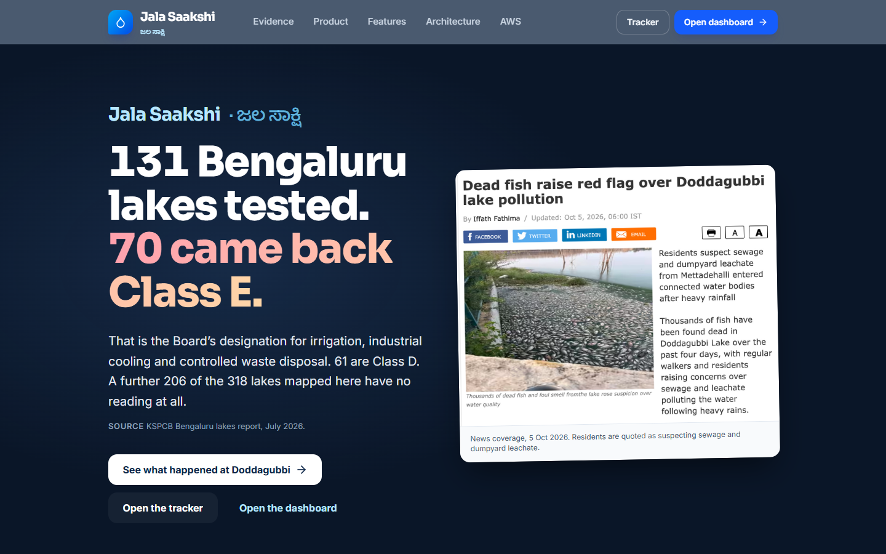
  <p><em>Jala Saakshi Landing Page: Highlighting the July 2026 KSPCB lake report data alongside the Doddagubbi fish kill crisis.</em></p>
</div>

### The Breaking Point: Doddagubbi Lake
From **October 1, 2026**, dead fish were reported at **Doddagubbi Lake** in northeastern Bengaluru, and by October 5 news coverage described thousands. Residents quoted in that coverage suspect sewage and leachate entering after heavy rain; we have not established a cause. The Board's July 2026 lake report had already listed the lake as **Class E**, with dissolved oxygen of 3 mg/L and BOD of 7 mg/L.

This was not an anomaly:
- The **National Green Tribunal (NGT)** documented **61 separate fish kill incidents** in Bengaluru lakes between 2017 and 2023.
- In **100% of cases**, water quality investigations concluded that **untreated sewage ingress was the primary cause**.
- Four of the repeat-offender lakes (*Bhattarahalli, Munnekolala, Chelekere, Iblur*) **already have their own sewage treatment plants (STPs)**.
- The NGT issued formal notices to **five separate agencies** (BBMP, KSPCB, CPCB, Fisheries Department, and the District Commissioner) — yet citizens remained locked out of the loop, unable to report what they saw or track whether anyone ever answered.

**Jala Saakshi (ಜಲ ಸಾಕ್ಷಿ — "The Water's Witness")** was born to bridge this divide.

---

## 🚨 The Problem Statement & Environmental Crisis

### The Core Problem Statement
> **How can ordinary citizens witness and document what is happening to their local water bodies, translate technical chemical data into actionable evidence, and hold responsible civic authorities accountable?**

### The Ecological Impact (general background, not specific to any one lake)
1. **Severe Dissolved Oxygen Depletion:** Untreated domestic sewage contains high organic loads. As aerobic bacteria decompose the organic matter, they consume all available dissolved oxygen (DO), driving levels below 2.0 mg/L (normal aquatic life requires > 4.0 mg/L), resulting in mass fish asphyxiation.
2. **Surface Froth:** Detergent surfactants are a commonly cited cause of froth on urban lakes, and froth has been reported historically at Bellandur and Varthur.
3. **Coliform Counts:** Coliform bacteria are the Board's indicator of faecal contamination. In the July 2026 report, **63 of the 131 lakes** record total coliform above 5,000 MPN/100 ml, the Class C limit, and the highest is 330,000.
4. **Information Asymmetry & Language Barrier:** Official water quality reports are published as scanned PDFs with merged table cells and technical terminology. We built a Kannada-first reporting flow so residents can report what they see in the language they use at the lake.

---

## 👥 Who It Is Built For: Two Distinct User Groups

Jala Saakshi connects two sides of the environmental accountability equation:

```
┌──────────────────────────────────────────────┐       ┌──────────────────────────────────────────────┐
│           GROUP 1: CITIZENS & WALKERS         │       │          GROUP 2: CIVIC AUTHORITIES          │
│          (Mobile Web App · Bilingual)        │       │         (Web Dashboard & Triage Queue)       │
├──────────────────────────────────────────────┤       ├──────────────────────────────────────────────┤
│ • Lakeside residents & morning walkers       │       │ • KSPCB & CPCB Environmental Officers        │
│ • Resident Welfare Associations (RWAs)       │       │ • BBMP Lakes Division Engineers              │
│ • Student citizen scientists & activists     │       │ • Fisheries Department & District Admin      │
├──────────────────────────────────────────────┤       ├──────────────────────────────────────────────┤
│ 📱 Native Kannada & English mobile UI        │       │ 💻 High-density desktop geospatial dashboard │
│ 🎙️ Kannada voice reporting via browser STT   │       │ ⏱️ Automated 7-day accountability clock      │
│ 📸 Photo upload with GPS location tag        │       │ 🗺️ River monitoring points vs. lake gap layer│
│ ✉️ 1-click evidence-backed complaint drafting│       │ 🔍 Incident triage queue (prototype)         │
└──────────────────────────────────────────────┘       └──────────────────────────────────────────────┘
```

---

## 📸 Key Features & Visual Tour

### 1. Citizen Experience: Mobile App & Kannada Voice
Designed specifically for mobile devices with high-contrast, tactile UI and **full bilingual support (ಕನ್ನಡ & English)**. A citizen at the lake can report pollution in seconds without typing.

<table align="center">
  <tr>
    <td align="center" width="25%">
      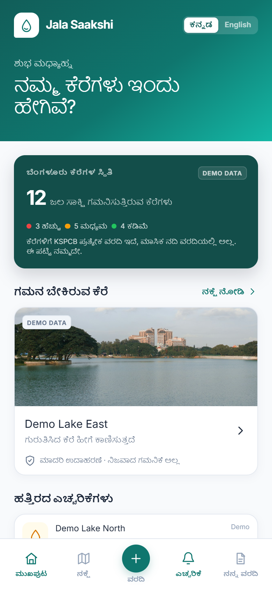<br />
      <b>1. Home Screen (ಕನ್ನಡ)</b><br />
      <em>Recent alerts, nearby lakes & quick report button</em>
    </td>
    <td align="center" width="25%">
      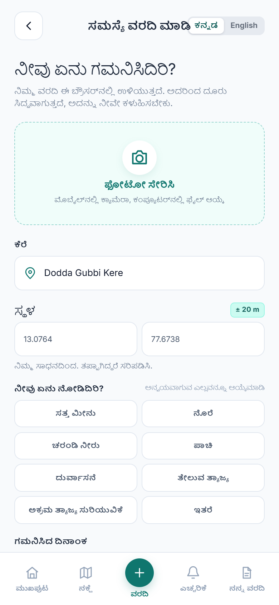<br />
      <b>2. Report Form</b><br />
      <em>Photo upload, GPS fix, and multi-issue tags</em>
    </td>
    <td align="center" width="25%">
      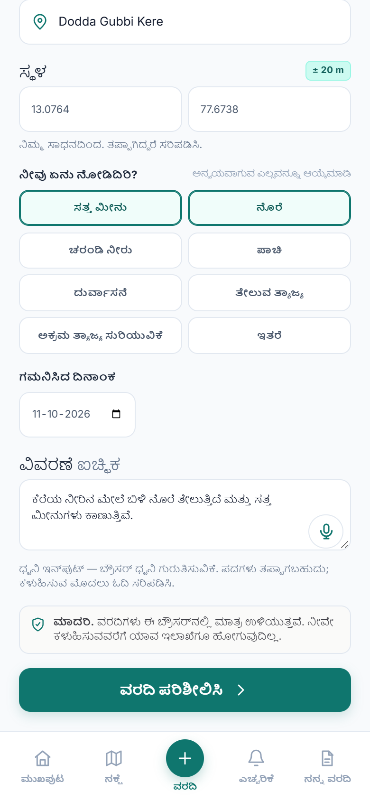<br />
      <b>3. Kannada Voice Input</b><br />
      <em>Dictate observations naturally in Kannada</em>
    </td>
    <td align="center" width="25%">
      <br />
      <b>4. Lake Map (ಕನ್ನಡ)</b><br />
      <em>318 mapped Bengaluru lakes, with the July 2026 class where tested</em>
    </td>
  </tr>
</table>

#### 🎙️ How Voice Input Works:
- Integrates the browser's speech recognition engine configured for **`kn-IN`** (Kannada) and **`en-IN`** (Indian English).
- Live audio is transcribed into an editable observation field, allowing residents to speak naturally without wrestling with phonetic keyboards.
- Architected for seamless drop-in replacement by **Amazon Transcribe** for high-accuracy server-side audio processing.

<table align="center">
  <tr>
    <td align="center" width="33%">
      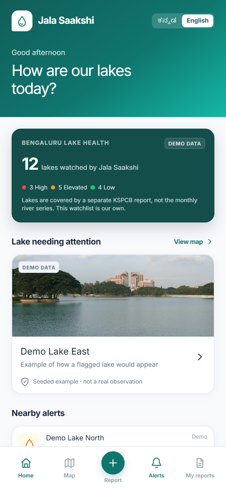<br />
      <b>English Interface</b><br />
      <em>1-tap toggle between Kannada & English</em>
    </td>
    <td align="center" width="33%">
      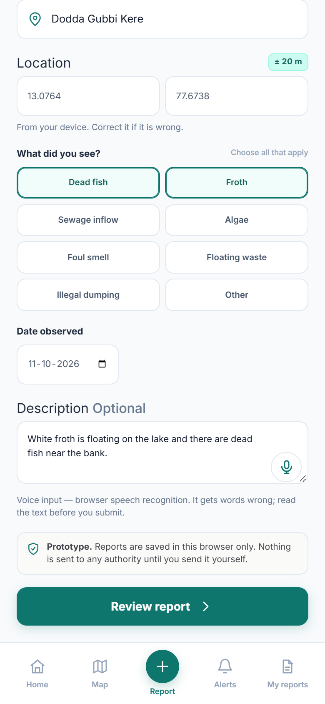<br />
      <b>English Voice Dictation</b><br />
      <em>Instant speech-to-text input</em>
    </td>
    <td align="center" width="33%">
      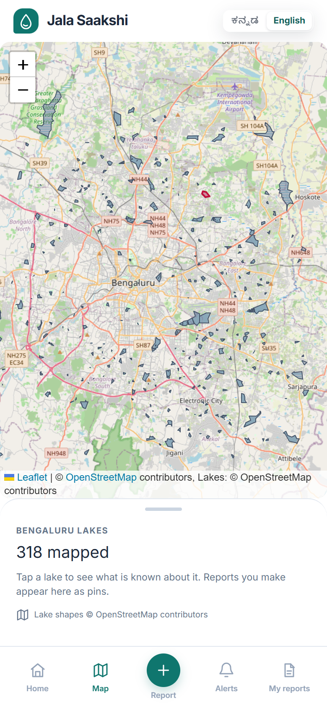<br />
      <b>Lake Status Overview</b><br />
      <em>Status markers color-coded & lettered</em>
    </td>
  </tr>
</table>

---

### 2. Authority & Civic Bodies Experience: Web Portal & Dashboard

#### 🏢 Authority Triage Portal (`#/authority`), prototype
A prototype of the triage queue that civic bodies (BBMP, KSPCB, Fisheries) would use. It runs on seeded example cases plus any reports filed in the same browser. It is not connected to a server or to any agency's systems.
- **Accountability Clock:** Counts the days a report has gone without acknowledgment; reports open for more than 7 days are counted as open.
- **Incident Categories:** Dead fish, froth, sewage inflow, algae, foul smell, floating waste, illegal dumping, or other, chosen by the person reporting.
- **Evidence:** The citizen's photo and location travel with the report. Automatic photo classification is designed (Amazon Bedrock) but not deployed.

<div align="center">
  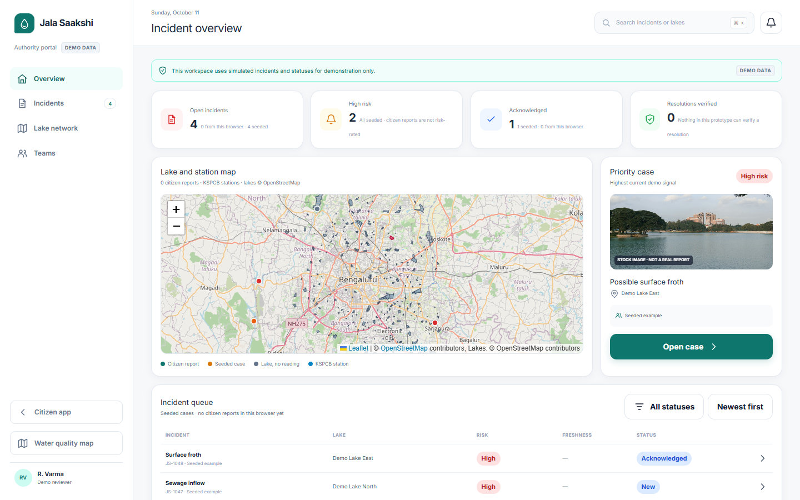
  <p><em>Authority Portal: Incident overview, risk ranking, response clock, and mapped citizen reports.</em></p>
</div>

#### 🗺️ Geospatial Water Quality Dashboard (`#/dashboard`)
A full desktop research interface displaying **8 years of water quality data across Karnataka**:
- **Timeline Scrubber:** Step through 29 monthly reports from April 2018 to August 2026.
- **Color-Blind Accessible Scale:** Points are lettered (`A`, `B`, `C`, `D`, `E`) and styled with distinct high-contrast hues.
- **The "Lake Gap Layer":** Overlays the 318 mapped lakes over KSPCB's river stations, coloured by the class in the July 2026 lakes report, with untested lakes in grey.

<div align="center">
  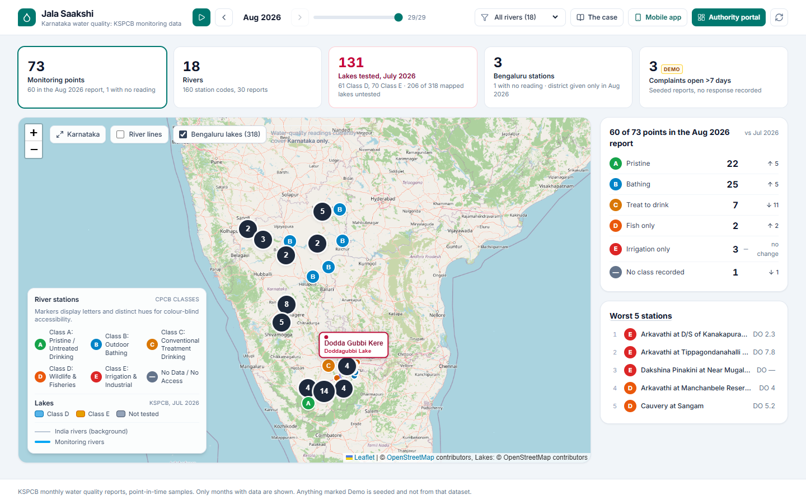
  <p><em>Geospatial Explorer: 73 active monitoring points, river polylines, CPCB classifications, and worst-performing stations.</em></p>
</div>

---

### 3. Discovering Lakes Near You (`#/near-me`)
Citizens can grant browser geolocation (it starts from central Bengaluru if they decline) to see what the Board recorded near them:
1. Finds every mapped lake within a **3 km radius**.
2. Shows the nearest tested lake's class, dissolved oxygen, BOD and total coliform from the July 2026 report.
3. Explains the class in the Board's own words.
4. Says how many mapped lakes have no reading at all.

<div align="center">
  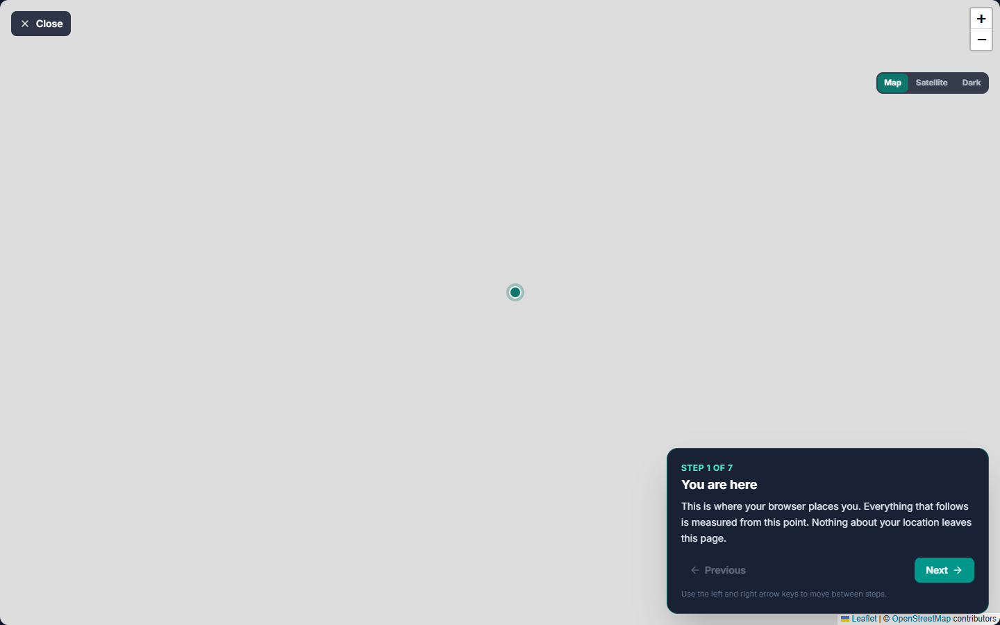
  <p><em>The near-me tour: a seven-step walk through the lakes around you and what the Board recorded.</em></p>
</div>

---

## 📊 The Data Provenance

To build Jala Saakshi, we excavated and standardized fragmented public data that was previously locked away:

| Dataset | Volume & Scope | Source | Processing Method |
| :--- | :--- | :--- | :--- |
| **Karnataka River Monitoring Reports** | **1,182 readings** from 73 monitoring points on 18 rivers (2018–2026) | KSPCB Monthly PRS Water Quality Reports | Extracted from 29 monthly reports (16 PDF files) with merged cells using a `pdfplumber` pipeline. |
| **Bengaluru Lakes Monitoring** | **131 lakes tested** (July 2026), 61 Class D and 70 Class E | KSPCB Bengaluru Lakes report, July 2026 | Parsed into structured JSON (`lakes-2026-07.json`). |
| **Bengaluru Lake Polygons** | **318 mapped lakes** (340 named OSM polygons, less 22 drains, channels and pools) | OpenStreetMap (OSM) Overpass API | Converted to GeoJSON (`all-lakes.geojson`) and matched by point-in-polygon, then nearest polygon within 300 m (`scripts/match-lakes.mjs`): 112 of the 131 tested lakes matched, 19 are shown as points. |
| **National River Network** | **23,826 river line features** | River network GeoJSON | Coordinates rounded to 5 decimal places (~1 m accuracy), reducing the file from 54 MB to 5.5 MB. |
| **Sentinel-2 L2A Satellite Imagery** | 5-day revisit multispectral tiles | **AWS Open Data Registry** (`s3://sentinel-cogs`) | True-colour 10 m scenes of Doddagubbi, six clear dates from May to October 2026. Our algae index is saturated and does not isolate the October event. |

---

## 🏗️ Architecture & System Design

Jala Saakshi uses a **serverless, data-first architecture** designed to be low-cost, infinitely scalable, and robust.

<div align="center">
  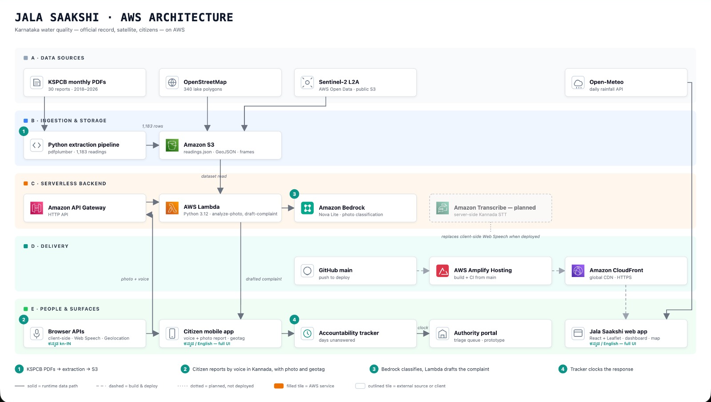
  <p><em>System Architecture: Static asset delivery, serverless AI pipelines, and bilingual frontend clients.</em></p>
</div>

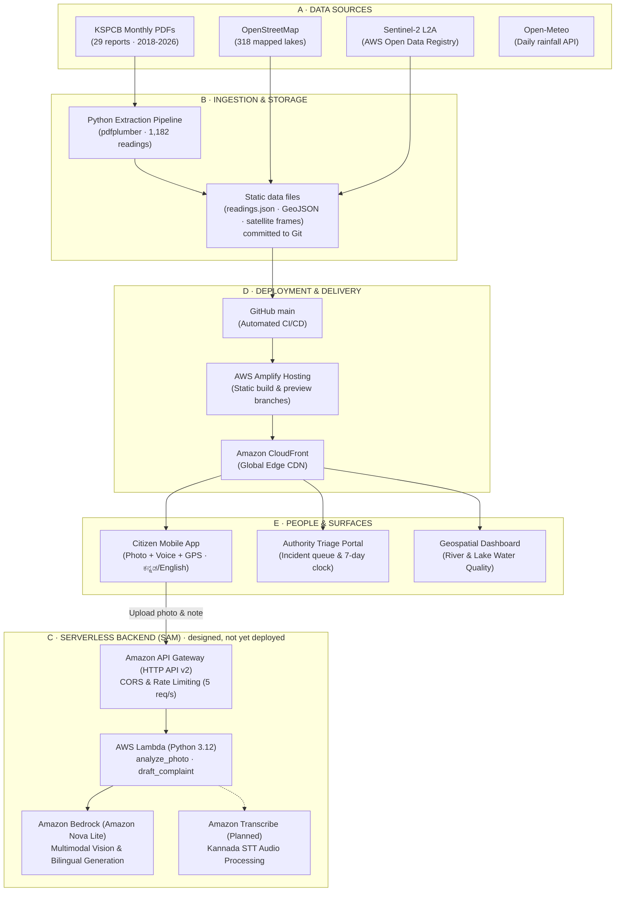

---

## ☁️ AWS Services Implementation (Judging Criteria)

Every AWS service is thoughtfully chosen to adhere to the AWS Well-Architected Framework:

| Service | Architecture Layer | Current Status | Why & How It Is Used |
| :--- | :--- | :---: | :--- |
| **AWS Amplify Hosting** | CI/CD & Static Delivery | `DEPLOYED` | Connects directly to Git `main`. Builds the Vite React SPA and automates SSL certificates, custom branch previews, and edge cache invalidation. |
| **Amazon CloudFront** | Content Delivery Network | `DEPLOYED` | Fronts Amplify Hosting to serve static JavaScript bundles, CSS, and multi-megabyte GeoJSON datasets across edge locations with sub-50ms latency in India. |
| **Amazon Bedrock** | Generative AI & Vision | `DESIGNED` | Utilizes **Amazon Nova Lite (`us.amazon.nova-lite-v1:0`)**: <br/>1. **Multimodal classification (`POST /analyze-photo`):** Detects surface froth, sewage outfalls, algal blooms, or fish mortality with severity scores (1–5).<br/>2. **Formal letter generation (`POST /draft-complaint`):** Synthesizes citizen observations with historical chemical readings to draft formal complaints in English, Kannada, and Hindi. |
| **AWS Lambda** | Serverless Compute | `DESIGNED` | Runs Python 3.12 handlers behind API Gateway. Completely decouples AI inferencing from client-side code so zero AWS credentials reach the browser. |
| **Amazon API Gateway** | Managed REST Interface | `DESIGNED` | HTTP API (v2) configured with strict CORS whitelist for the Amplify domain, payload size limits (rejects > 4MB), and throttling (5 requests/sec, burst 10) to eliminate DDoS risks. |
| **Static data files** | Dataset delivery | `DEPLOYED` | No S3 bucket is used or declared today. The datasets (`readings.json`, `lakes-2026-07.json`, GeoJSON, satellite frames) are files in the repo, served through Amplify and CloudFront. `VITE_DATA_URL` lets the app read readings from elsewhere, such as a bucket, later. |
| **AWS Open Data Registry** | Geospatial Data Source | `INTEGRATED` | Consumes public **Sentinel-2 L2A Cloud-Optimized GeoTIFFs (COGs)** directly from `s3://sentinel-cogs` without incurring licensing or egress storage fees. |
| **Amazon CloudWatch** | Monitoring & Logging | `DESIGNED` | Captures Lambda latency, invocation rates, and error traces while sanitizing base64 image payloads from log streams to protect privacy. |
| **AWS IAM** | Security & Access Control | `DESIGNED` | Implements strict least-privilege roles for Lambda execution, scoped specifically to `bedrock:InvokeModel` on the Nova Lite inference profile. |
| **Amazon Transcribe** | Speech-to-Text | `PLANNED` | Architectural next step to supplement the browser's Web Speech API with managed server-side Kannada transcription for low-end Android smartphones. |
| **Amazon Cognito** | Authentication | `PLANNED` | Planned RBAC module to secure the **Authority Triage Portal** for verified municipal and environmental officers. |

---

## 💻 Quick Start & Local Development

### Prerequisites
- **Node.js** ≥ 20.19 (22 recommended, see `.nvmrc`)
- **Python** ≥ 3.10
- **npm** ≥ 9

### 1. Clone & Install Dependencies
```bash
git clone https://github.com/mithali-netizen/tiramisu.git
cd tiramisu
npm install
```

### 2. Run the Frontend
```bash
npm run dev
```
Open [http://localhost:5173](http://localhost:5173) in your browser:
- `http://localhost:5173/#/` — Landing Page & Doddagubbi Crisis
- `http://localhost:5173/#/app` — Citizen Mobile App (Kannada/English)
- `http://localhost:5173/#/near-me` — 3km Lake Discovery Flow
- `http://localhost:5173/#/dashboard` — Water Quality Explorer
- `http://localhost:5173/#/authority` — Authority Triage Portal

### 3. Run the AI Backend (Zero AWS Cost)
The backend includes a zero-dependency local server with a built-in Bedrock mock mode:
```bash
# In another terminal window:
python backend/local_server.py
```
- Starts on `http://localhost:8787` with `MOCK_BEDROCK=true`.
- Allows testing `/analyze-photo` and `/draft-complaint` without AWS credentials.
- To connect to live Amazon Bedrock, set `MOCK_BEDROCK=false` and provide AWS credentials.

### 4. Run Unit Tests
```bash
# Run backend test suite (10 unit tests for input validation, Bedrock parsing & fallback)
python -m pytest backend/tests/ -v

# Run frontend linter
npm run lint
```

### 5. Production AWS SAM Deployment
When ready to deploy the serverless backend to AWS:
```bash
cd backend
sam build
sam deploy --guided
```

---

## 👩‍💻 Project Team & Attributions

Created with ❤️ for Bengaluru's lakes by:
- **Sreeya Chand** — Frontend Architecture, Geospatial Visualizations & Story Design
- **Mithali Netizen** — Data Pipeline Engineering, KSPCB PDF Extraction & Spatial Matching
- **Prapti** — Backend SAM Architecture, Bedrock Prompt Engineering & UX Design

### Official Data Citations
- **Water Quality Data:** Karnataka State Pollution Control Board (KSPCB) Monthly Monitoring Reports (2018–2026).
- **Fish Kill Statistics:** National Green Tribunal (NGT) Suo Motu Proceedings, as cited in *Deccan Herald* (June 2024).
- **Incident Coverage:** *Bangalore Mirror*, "Dead fish raise red flag over Doddagubbi lake pollution", 5 October 2026.
- **Basemaps & Boundaries:** OpenStreetMap contributors; Esri (satellite and dark basemaps in the near-me tour).

---

<div align="center">
  <b>Jala Saakshi · ಜಲ ಸಾಕ್ಷಿ</b><br/>
  <i>Every lake deserves a witness.</i>
</div>
